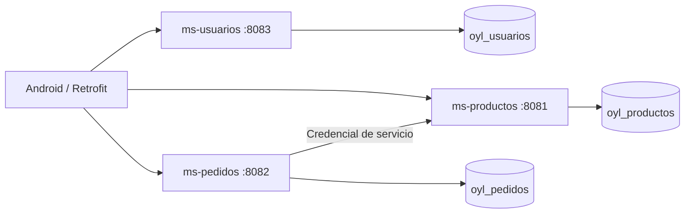

# OYL Frutos Secos — Backend

Backend académico de **DSY1105 — Desarrollo de Aplicaciones Móviles**, Duoc UC. Tres microservicios Spring Boot administran usuarios, productos/inventario y pedidos; Android consume sus APIs mediante Retrofit.

| Recurso | Ubicación |
|---|---|
| Backend | [fabcornejom/OYL-Backend](https://github.com/fabcornejom/OYL-Backend) |
| Android y pruebas del cliente | [APP_Movil_Frutos, desarrollo-marco](https://github.com/AcxelGonzalez/APP_Movil_Frutos/tree/desarrollo-marco) |
| Gestión | [Tablero Trello registrado por el equipo](https://trello.com/b/CZow21QV/proyecto-app) |
| Colección existente | [oyl_backend.postman_collection.json](oyl_backend.postman_collection.json) |

**Equipo:** Acxel González, Kerly Dugarte, Marco Carrasco y Fabián Cornejo. **Docente:** Cristian Gomez Vega.

Esta guía describe `desarrollo-marco`, con lógica revisada hasta `b2c148e`. Los comandos son para un entorno académico local. No se debe asumir que `main` o `desarrollo` contienen los mismos avances sin comparar sus revisiones.

## Contenido

1. [Arquitectura y tecnologías](#arquitectura-y-tecnologías)
2. [Reglas del negocio](#reglas-del-negocio)
3. [Autenticación y configuración](#autenticación-y-configuración)
4. [Instalación con Docker](#instalación-con-docker)
5. [Migraciones y actualización](#migraciones-y-actualización)
6. [Respaldo y conservación de datos](#respaldo-y-conservación-de-datos)
7. [Contratos HTTP](#contratos-http)
8. [Integración con Android](#integración-con-android)
9. [Compilación fuera de Docker](#compilación-fuera-de-docker)
10. [Verificación y problemas frecuentes](#verificación-y-problemas-frecuentes)
11. [Estructura y colaboración](#estructura-y-colaboración)

## Arquitectura y tecnologías



| Componente | Configuración declarada |
|---|---|
| Java | **25** en los tres módulos |
| Spring Boot | **4.1.2** en productos; **4.2.0** en pedidos y usuarios |
| Construcción | Maven Wrapper por microservicio; sin POM agregador en la raíz |
| Persistencia | Spring Data JPA/Hibernate y JdbcTemplate para registros de operaciones |
| Base de datos | Imagen Docker `postgres:17` |
| Seguridad | Spring Security, JWT RSA/RS256 y BCrypt |
| Contenedores | Docker Compose; imágenes Java 25 JDK para compilar y JRE para ejecutar |

| Servicio | Puerto en PC | Base | Responsabilidad |
|---|---:|---|---|
| `ms-productos` | 8081 | `oyl_productos` | Catálogo, fotos, stock y comprobantes de inventario |
| `ms-pedidos` | 8082 | `oyl_pedidos` | Compras recuperables, pedidos, estados y cancelaciones |
| `ms-usuarios` | 8083 | `oyl_usuarios` | Registro, autenticación y datos de perfil |
| `postgres` | **5433** | Las tres bases | En la red Docker escucha en **5432** |

Las bases están separadas lógicamente dentro del mismo motor/volumen. Los servicios no coordinan compras mediante consultas directas a tablas ajenas: `ms-pedidos` llama por HTTP a `ms-productos`. Compose usa una cuenta académica compartida de PostgreSQL; la separación de bases no implica aislamiento mediante roles distintos.

## Reglas del negocio

### Catálogo y fotografías

- El código identifica de forma única al producto ignorando mayúsculas; los índices manuales refuerzan esa regla ante escrituras concurrentes.
- Eliminar un producto es una **baja lógica**: queda oculto del catálogo y conserva su identidad para historial y devoluciones. Su código no queda libre para reutilizarlo.
- Editar metadatos de un producto existente conserva el stock persistido; no utilizar `PUT` para sobrescribir existencias con un valor antiguo del teléfono.
- Las entradas/salidas administrativas utilizan el contrato de movimientos con UUID por cuenta. El `PATCH /stock` anterior tiene uso interno de servicio.
- Las fotos se envían como multipart, se comprueban por contenido y se guardan en PostgreSQL como JPEG procesado, sin metadatos originales. No se guardan rutas privadas del teléfono como si fueran archivos compartidos.
- Límite de foto recibida/procesada: 2 MB; solicitud multipart: 3 MB. Se admiten imágenes JPG/PNG, con dimensiones de entrada hasta 4096 por eje y salida reducida a un máximo de 1024 por eje.
- La referencia compartida es `/api/productos/{id}/foto/{version}`. Descargarla requiere JWT; una versión anterior puede devolver `404` tras actualizarla. La respuesta utiliza `Cache-Control: no-store`.

### Compra recuperable

1. Android conserva localmente el intento antes del primer envío.
2. `POST /api/pedidos` exige `Idempotency-Key` con UUID canónico minúsculo y un usuario coincidente con el JWT.
3. `ms-pedidos` registra la intención durable, normaliza líneas y solicita una compra a inventario.
4. `ms-productos` valida productos, disponibilidad, cantidades y precio esperado; registra el resultado y el descuento del lote dentro de su transacción.
5. `ms-pedidos` verifica el comprobante, guarda pedido/detalles y marca la solicitud como completada.

No hay una transacción distribuida entre ambas bases. Si falla la respuesta después del descuento, se conserva la intención y se recupera mediante la misma clave. No se devuelve stock a ciegas ni se crea otra intención para sustituir una respuesta incierta.

La misma clave y contenido devuelven el resultado registrado sin otro descuento. Cambiar contenido conservando la clave produce conflicto. El precio enviado por Android es el precio **esperado**: se contrasta con inventario, no se acepta como fuente del precio real. Máximo de 200 líneas por solicitud y total compatible con `Int.MAX_VALUE` del cliente actual.

| Estado de solicitud | Interpretación |
|---|---|
| `NO_RECIBIDA` | La consulta no encuentra esa intención para el usuario |
| `EN_REVISION` | Existe la intención y falta confirmar su resultado |
| `COMPLETADA` | Devuelve el pedido registrado |
| `RECHAZADA` | Resultado durable de rechazo de inventario |
| `FINALIZADA_SIN_PEDIDO` | La compra terminó, pero su pedido ya no está disponible; no se reenviará |

`GET /solicitudes/{clave}` no descuenta ni crea pedidos. Continuar significa repetir explícitamente el POST original, con la misma cuenta, UUID y contenido.

### Estados y cancelación

```text
PENDIENTE_VALIDACION → CONFIRMADO → PREPARADO → ENTREGADO
```

El stock se descuenta **al registrar la compra**, no al confirmar administrativamente ni al entregar. Solo se permite avanzar un paso. Android verifica las cantidades por QR antes de preparar; el backend valida la transición, sin recibir evidencia criptográfica del escaneo.

Solo se cancela un pedido pendiente de validación. La intención de cancelación se conserva, se solicita una devolución idempotente y, tras confirmar la devolución, se eliminan pedido/detalles y se completa el registro de cancelación. Repetir la cancelación no vuelve a acreditar stock. Puede devolverse stock de un producto retirado lógicamente. Una cancelación en revisión impide avanzar el pedido mientras se resuelve.

### Movimientos administrativos

Se identifican por **administrador + UUID**. `cambio` es un entero distinto de cero y de `Integer.MIN_VALUE`: positivo para entrada, negativo para salida. Se rechazan stock negativo y desbordamientos. La respuesta incluye actor, clave, producto, cantidad y, cuando se aplicó, existencias anterior/resultante.

`GET` consulta sin reenviar. `POST` continúa la misma intención; cambiar producto/cantidad con la misma clave provoca conflicto. Los resultados `APLICADA` y `RECHAZADA` son terminales; `ABIERTA` indica revisión y `NO_REGISTRADA` que no se encuentra el movimiento de esa cuenta. Un comprobante histórico no representa necesariamente las existencias actuales.

## Autenticación y configuración

Solo **POST login y registro** son públicos. Los recursos restantes necesitan JWT o, en rutas internas concretas, la credencial de inventario.

El login devuelve `usuario`, `accessToken`, `tokenType` y `expiresAtEpochSeconds`. Se emite JWT RS256 con duración de **3.600 segundos**, emisor `oyl-usuarios`, audiencia `oyl-api`, usuario numérico en `sub` y rol `ADMIN`/`CLIENTE` en `role`. No hay endpoint de refresh token; al vencer se inicia sesión nuevamente.

Las contraseñas se almacenan mediante hash BCrypt y no se devuelven en las respuestas. El registro público crea clientes, nunca administradores. Alias/correo se comparan sin distinguir mayúsculas. La contraseña de registro tiene mínimo de ocho caracteres y límite de 72 bytes UTF-8 para BCrypt; no equivale a 72 caracteres multibyte. Nombre de perfil y presentación del producto admiten hasta 255 caracteres.

### Archivos locales de seguridad

| Archivo excluido de Git | Uso |
|---|---|
| `.oyl-secrets/jwt-private.pem` | Firma de JWT; solo `ms-usuarios` |
| `.oyl-secrets/jwt-public.pem` | Verificación de JWT en los tres servicios |
| `.oyl-secrets/stock-service.token` | Credencial compartida de `ms-pedidos` y `ms-productos` |

`tools/PrepararSeguridad.java` crea RSA de 3072 bits y un token aleatorio. Si los tres archivos existen no los reemplaza; si falta solo parte de la configuración, se detiene. No borrar/regenerar las claves para resolver un arranque sin revisar primero su origen. Cambiar las claves puede invalidar sesiones existentes y romper la comunicación si los servicios no coinciden.

La cabecera interna `X-Oyl-Service-Token` tiene alcance restringido y rol `STOCK_SERVICE`; no sustituye el JWT del usuario en las rutas administrativas ni se distribuye a Android. No subir archivos secretos ni incluir sus valores en capturas/logs/documentación.

### Propiedades de entorno

| Variable | Función |
|---|---|
| `SPRING_DATASOURCE_URL` | JDBC de la base de cada servicio |
| `SPRING_DATASOURCE_USERNAME`, `SPRING_DATASOURCE_PASSWORD` | Credenciales locales de PostgreSQL |
| `OYL_SECURITY_PUBLIC_KEY` | Recurso `file:` con la clave pública |
| `OYL_SECURITY_PRIVATE_KEY` | Recurso `file:` privado, en usuarios |
| `OYL_SECURITY_STOCK_TOKEN` | Recurso `file:` para credencial interna |
| `PRODUCTOS_URL` | Dirección que pedidos usa para contactar productos |

Compose monta los secretos en `/run/secrets/` y conecta a PostgreSQL por nombre `postgres:5432`. Fuera de Docker, los `application.properties` apuntan por defecto a PostgreSQL nativo en `localhost:5432`; para utilizar el contenedor desde el PC hay que sobrescribirlos a `localhost:5433`.

## Instalación con Docker

Ejemplos PowerShell desde la raíz del backend. Requisitos: Git, Docker Desktop/motor activo, Docker Compose y **JDK 25** para ejecutar la herramienta de preparación en el PC. Maven y PostgreSQL nativos no son necesarios para compilar/ejecutar mediante contenedores.

### 1. Obtener la rama y comprobar herramientas

```powershell
git clone --branch desarrollo-marco https://github.com/fabcornejom/OYL-Backend.git
cd OYL-Backend
git status
java -version
docker version
docker compose version
```

### 2. Preparar claves sin mostrar sus valores

```powershell
java tools/PrepararSeguridad.java
docker compose config --quiet
```

Alternativa sin JDK instalado, ejecutando la herramienta mediante Java del contenedor:

```powershell
docker run --rm -v "${PWD}:/workspace" -w /workspace eclipse-temurin:25-jdk java tools/PrepararSeguridad.java
```

La primera ejecución descarga imágenes/dependencias y requiere red. No copiar `.oyl-secrets` de otra persona salvo que el equipo acuerde compartir ese entorno de autenticación.

### 3. Construir y arrancar

```powershell
docker compose up -d --build
docker compose ps
docker compose logs --tail 80 ms-productos ms-pedidos ms-usuarios
```

Los Dockerfiles ejecutan Maven con **`-DskipTests`**. Que las imágenes compilen no significa que hayan corrido pruebas del backend.

El volumen `pgdata` conserva las bases. `docker/init-db.sql` crea `oyl_productos`, `oyl_pedidos` y `oyl_usuarios` **solo cuando PostgreSQL inicializa un volumen vacío**. No recrea bases faltantes en un volumen existente. Hibernate prepara las entidades y los SQL de recursos crean los registros aditivos de compras/cancelaciones/fotos; ver las migraciones manuales antes de usar inventario.

Productos carga cinco artículos demo solo si su tabla está vacía. Usuarios comprueba `admin` y `cliente` al arrancar y crea la cuenta que falte, incluso en una base anterior. No sobrescribe simplemente todas las cuentas al iniciar. Las credenciales académicas están definidas por el proyecto; no se reproducen en esta guía.

### 4. Completar esquema antes de usar la app

En una instalación nueva todavía es necesario aplicar las tres migraciones manuales descritas abajo, después de crear las tablas de entidades. **No usar el flujo de movimientos hasta que exista `movimientos_stock`.** Los índices por mayúsculas también forman parte de la configuración completa.

En una base existente, revisar cuáles ya se aplicaron: los scripts son de una sola aplicación y no deben ejecutarse indiscriminadamente.

### 5. Comprobar con autenticación

Ejemplo de consulta; solicita credenciales sin escribirlas en el README ni imprimir el token:

```powershell
$oylCredencial = Get-Credential -UserName admin -Message 'Cuenta académica OYL'
$oylCuerpo = @{
    alias = $oylCredencial.UserName
    contrasena = $oylCredencial.GetNetworkCredential().Password
} | ConvertTo-Json
$oylLogin = Invoke-RestMethod -Method Post -Uri http://localhost:8083/api/usuarios/login -ContentType 'application/json' -Body $oylCuerpo
$oylCabeceras = @{ Authorization = 'Bearer ' + $oylLogin.accessToken }
Invoke-RestMethod -Uri http://localhost:8081/api/productos -Headers $oylCabeceras
Invoke-RestMethod -Uri http://localhost:8082/api/pedidos -Headers $oylCabeceras
```

No copiar `$oylLogin`, `$oylCuerpo` ni `$oylCabeceras` a capturas. Sin autenticación, un `401` es esperado y no demuestra que el servicio esté caído. No existe un endpoint Actuator público configurado para sustituir esta comprobación.

## Migraciones y actualización

### Qué se aplica automáticamente

`spring.jpa.hibernate.ddl-auto=update` prepara entidades. Los recursos `idempotencia.sql` de productos/pedidos crean tablas aditivas con `IF NOT EXISTS`; productos añade `eliminado=false`. Productos difiere ese SQL hasta después de Hibernate por la referencia de fotos a productos.

| Base | Tablas principales/aditivas |
|---|---|
| `oyl_usuarios` | `usuarios` |
| `oyl_productos` | `productos`, `compras_stock`, `compras_stock_detalles`, `devoluciones_stock`, `fotos_producto`, **`movimientos_stock` manual** |
| `oyl_pedidos` | `pedidos`, `detalles_pedido`, `solicitudes_compra`, `cancelaciones_pedido` |

### Qué requiere ejecución manual

| Archivo | Base | Resultado |
|---|---|---|
| `docker/migraciones/20261124_usuarios_unicidad.sql` | `oyl_usuarios` | Índices únicos `UPPER(alias)` y `UPPER(correo)` |
| `docker/migraciones/20261124_productos_unicidad.sql` | `oyl_productos` | Índice único `UPPER(codigo)`, incluidos productos retirados |
| `docker/migraciones/20261124_movimientos_stock.sql` | `oyl_productos` | Registro durable de movimientos con comprobaciones de cantidades/stock |

Estos archivos **no se cargan al arrancar**. Verifican la base esperada y ejecutan una transacción. Los de unicidad comprueban duplicados y bloquean escrituras durante la creación. Si ya existen los nombres de índices/tabla, hay duplicados o no se obtiene el bloqueo, se detienen; no corrigen ni borran registros por su cuenta.

Procedimiento para actualizar una base con datos:

1. Revisar rama/commit y cambios de esquema. Detener uso de Android y otros clientes.
2. Detener microservicios para impedir escrituras: `docker compose stop ms-pedidos ms-productos ms-usuarios`.
3. Respaldar las tres bases y comprobar que los archivos son legibles.
4. Consultar tablas/índices y aplicar **solo** los scripts pendientes. Una tabla con nombre correcto pero estructura diferente requiere revisión, no un borrado.
5. Reconstruir/arrancar servicios y revisar logs, esquema y consultas autenticadas.
6. Contrastar conteos/datos anteriores y realizar una validación funcional con datos ficticios identificables.

En una instalación nueva, dejar que el primer arranque cree las tablas, detener microservicios y aplicar los scripts pendientes antes de habilitar clientes.

Consulta de existencia, de solo lectura:

```powershell
docker compose exec -T postgres psql -X -U postgres -d oyl_productos -c "SELECT to_regclass('public.movimientos_stock'), to_regclass('public.oyl_productos_codigo_ci_uq');"
docker compose exec -T postgres psql -X -U postgres -d oyl_usuarios -c "SELECT to_regclass('public.oyl_usuarios_alias_ci_uq'), to_regclass('public.oyl_usuarios_correo_ci_uq');"
```

Ejemplos **solo si están pendientes**, con respaldo y revisión previos; no ejecutarlos nuevamente sobre la base ya migrada:

```powershell
Get-Content -Raw docker/migraciones/20261124_usuarios_unicidad.sql | docker compose exec -T postgres psql -X -U postgres -d oyl_usuarios -v ON_ERROR_STOP=1
if ($LASTEXITCODE -ne 0) { throw 'Detener: revisar migración de usuarios' }
Get-Content -Raw docker/migraciones/20261124_productos_unicidad.sql | docker compose exec -T postgres psql -X -U postgres -d oyl_productos -v ON_ERROR_STOP=1
if ($LASTEXITCODE -ne 0) { throw 'Detener: revisar migración de productos' }
Get-Content -Raw docker/migraciones/20261124_movimientos_stock.sql | docker compose exec -T postgres psql -X -U postgres -d oyl_productos -v ON_ERROR_STOP=1
if ($LASTEXITCODE -ne 0) { throw 'Detener: revisar migración de movimientos' }
```

Conservar cada script completo; no ejecutar sus líneas por separado. En Linux/macOS usar redirección de entrada a `psql` y comprobar su código de salida. Hibernate `update` no equivale a un historial versionado completo de migraciones.

## Respaldo y conservación de datos

Con microservicios detenidos, PostgreSQL puede seguir activo. Respaldar las tres bases como conjunto para conservar la relación lógica entre pedido y stock. Un `pg_dump` aislado con servicios escribiendo no garantiza consistencia entre las tres bases.

Ejemplo PowerShell; guarda fuera del repositorio y evita redirigir binarios mediante versiones antiguas de PowerShell:

```powershell
$oylRespaldo = Join-Path $env:USERPROFILE ('OYL-respaldos/' + (Get-Date -Format 'yyyyMMdd-HHmmss'))
New-Item -ItemType Directory -Path $oylRespaldo -Force | Out-Null
foreach ($oylBase in @('oyl_productos','oyl_pedidos','oyl_usuarios')) {
    docker compose exec -T postgres pg_dump -U postgres -d $oylBase -Fc -f "/tmp/$oylBase.dump"
    if ($LASTEXITCODE -ne 0) { throw 'Falló pg_dump; detener' }
    docker compose exec -T postgres pg_restore --file=/dev/null "/tmp/$oylBase.dump"
    if ($LASTEXITCODE -ne 0) { throw 'Respaldo no decodificable; detener' }
    docker compose cp "postgres:/tmp/$oylBase.dump" (Join-Path $oylRespaldo "$oylBase.dump")
    if ($LASTEXITCODE -ne 0) { throw 'Falló copia del respaldo; detener' }
}
Get-FileHash -Algorithm SHA256 -Path (Join-Path $oylRespaldo '*.dump')
```

`pg_restore --file=/dev/null` decodifica el archivo sin conectarse ni restaurarlo; no demuestra una recuperación completa. Probar restauración en una base/volumen independiente antes de depender del respaldo. No sobrescribir las bases activas como procedimiento de prueba.

`docker compose stop` conserva contenedores/datos. `docker compose down` retira contenedores y red y conserva el volumen nombrado. La opción `down -v` **elimina el volumen y sus datos**; no utilizarla para actualizar, aplicar migraciones ni resolver un conflicto de puertos. No cambiar la imagen de PostgreSQL de versión mayor sobre el mismo directorio de datos sin una migración compatible.

En el PC utilizado para la revisión, Docker usó PostgreSQL 17 por 5433. La instalación nativa de PostgreSQL 19 por 5432 es independiente y no fue sustituida ni utilizada como reemplazo automático de ese volumen.

## Contratos HTTP

Todas las rutas de esta sección son relativas al servicio/puerto correspondiente. `propio` significa el usuario/propietario del JWT, no un identificador elegido libremente por Android.

### Usuarios — 8083

| Método | Ruta | Acceso y resultado |
|---|---|---|
| POST | `/api/usuarios/registro` | Público; crea `CLIENTE`, responde 201 con datos públicos |
| POST | `/api/usuarios/login` | Público; devuelve usuario y JWT |
| GET | `/api/usuarios` | Admin |
| GET | `/api/usuarios/{id}` | Admin o cliente propio |
| PUT | `/api/usuarios/{id}` | Admin o propio; nombre, correo, teléfono y dirección |
| DELETE | `/api/usuarios/{id}` | Admin; elimina cuenta, responde 204 |

Login recibe `{"alias":"...","contrasena":"..."}`. Registro utiliza `nombre`, `alias`, `correo`, `telefono`, `direccion` opcional y `contrasena`. Editar perfil no es un contrato para cambiar alias, contraseña o rol.

### Productos — 8081

| Método | Ruta | Acceso/contrato |
|---|---|---|
| GET | `/api/productos` | Admin/cliente; catálogo sin productos eliminados |
| GET | `/api/productos/stock-bajo` | Admin |
| GET | `/api/productos/{id}` | Admin/cliente o servicio interno autorizado |
| POST | `/api/productos` | Admin; ficha JSON |
| PUT | `/api/productos/{id}` | Admin; conserva stock existente |
| DELETE | `/api/productos/{id}` | Admin; baja lógica |
| POST | `/api/productos/con-foto` | Admin; partes multipart `producto` JSON y `foto` binaria |
| PUT | `/api/productos/{id}/con-foto` | Admin; ficha y reemplazo de foto |
| GET | `/api/productos/{id}/foto/{version}` | Admin/cliente; JPEG autenticado |
| POST | `/api/productos/movimientos-stock/{clave}` | Admin; aplicar/continuar ajuste UUID de esa cuenta |
| GET | `/api/productos/movimientos-stock/{clave}` | Admin; solo consulta |
| POST | `/api/productos/compras-stock` | Solo servicio interno; lote idempotente |
| POST | `/api/productos/devoluciones-stock` | Solo servicio interno; devolución idempotente |
| PATCH | `/api/productos/{id}/stock` | Solo servicio interno; compatibilidad, no flujo admin actual |

Ficha de producto: `nombre`, `codigo`, `categoria`, `descripcion`, `presentacion`, `precio`, `stock`, `stockMinimo`, `disponible`, `imagenUrl`. En multipart, la parte `producto` debe llevar contenido `application/json`. Eliminar lógicamente no libera el código ni reinicia la secuencia de IDs.

Movimiento: `{"productoId":7,"cambio":3}` enviado con JWT de administrador a una ruta cuyo `{clave}` es UUID. Para reintentar, conservar la misma ruta y cuerpo; no generar otro UUID ante timeout.

### Pedidos — 8082

| Método | Ruta | Acceso/contrato |
|---|---|---|
| POST | `/api/pedidos` | Cliente; JWT propio e `Idempotency-Key` obligatorio |
| GET | `/api/pedidos/solicitudes/{clave}` | Cliente propio; consulta sin envío |
| GET | `/api/pedidos` | Admin; filtro opcional `?estado=CONFIRMADO` |
| GET | `/api/pedidos/usuario/{usuarioId}` | Admin o cliente propio |
| GET | `/api/pedidos/{id}` | Admin o propietario |
| PATCH | `/api/pedidos/{id}/estado` | Admin; `{"estado":"CONFIRMADO"}` |
| POST | `/api/pedidos/{id}/cancelacion` | Admin o propietario; iniciar/continuar |
| GET | `/api/pedidos/{id}/cancelacion` | Admin o propietario; consultar |
| DELETE | `/api/pedidos/{id}` | Compatibilidad; misma cancelación durable |

Ejemplo de cuerpo de compra (IDs ilustrativos; sustituir por cuenta y catálogo actuales):

```json
{
  "usuarioId": 7,
  "items": [
    {"productoId": 4, "cantidad": 2, "precioEsperado": 1000}
  ]
}
```

El POST devuelve `{ "estado": "...", "mensaje": null, "pedido": ... }`: no asumir que cualquier HTTP 200 equivale a compra completada. El cliente interpreta `estado` y verifica el comprobante. Un pedido incluye sus detalles, total, fecha, estado y señal `cancelacionEnRevision`.

Cancelación devuelve `pedidoId`, `usuarioId`, `estado` y `mensaje`. El DELETE de compatibilidad responde 200 para completada, 409 para rechazada y 202 para revisión. El contrato actual de Android utiliza POST/GET explícitos.

### Errores

| Código | Interpretación habitual |
|---|---|
| 400 | Entrada/formato inválido |
| 401 | Credencial ausente, inválida o vencida |
| 403 | Rol o propietario sin permiso |
| 404 | Recurso no disponible o fotografía versionada antigua |
| 409 | Duplicado, transición/conflicto o clave reutilizada con otro contenido |
| 5xx/timeout | Fallo de servicio o respuesta incierta; conservar la identidad de la operación |

Los resultados de negocio durables también pueden venir dentro de HTTP satisfactorio. No realizar reintentos ciegos por código HTTP. La colección Postman existente es material auxiliar: revisar autenticación, UUID y rutas contra esta tabla antes de ejecutar solicitudes que escriban datos.

## Integración con Android

Android configura `oylBackendHost` al compilar; no editar los puertos ni incrustar credenciales de servicio. Emulador estándar: `http://10.0.2.2`; teléfono USB: `http://127.0.0.1` y `adb reverse` para 8081/8082/8083; WiFi: IP LAN accesible del PC. Consultar el README Android para comandos completos.

El backend no tiene campos para los complementos locales de **RUT, apellido, avatar ni entrega acordada del pedido**. La dirección de perfil remota es distinta de esa copia de entrega. Otro dispositivo puede ver el pedido remoto, pero no necesariamente sus complementos conservados en el primer teléfono. No presentar estos datos como sincronizados entre equipos.

Las notificaciones siguen estáticas/locales y no hay servicio push configurado. La API externa adicional fue excluida por decisión del equipo; documentar esa decisión no equivale a una exoneración formal de la rúbrica.

## Compilación fuera de Docker

Requiere JDK **25** y cada Maven Wrapper. Ejecutar en tres carpetas, porque no existe tarea Maven única en la raíz:

```powershell
cd ms-productos
.\mvnw.cmd package -DskipTests
cd ../ms-pedidos
.\mvnw.cmd package -DskipTests
cd ../ms-usuarios
.\mvnw.cmd package -DskipTests
```

Para iniciar un módulo mediante `.\mvnw.cmd spring-boot:run -DskipTests`, antes configurar JDBC, credenciales y rutas `file:` correctas y mantener disponibles las otras dependencias. Ejecutar desde la carpeta del módulo para que `../.oyl-secrets/` corresponda a la raíz del backend. `ms-pedidos` debe usar una URL de productos alcanzable desde su proceso.

No confundir JDK 25 del backend con JDK 17 de Android. Configurar cada terminal/proyecto por separado.

## Verificación y problemas frecuentes

El alcance acordado de pruebas automáticas es **Android**. En este avance no se ejecutaron pruebas unitarias del backend. Se compiló con pruebas omitidas y se validaron los servicios reales a través del cliente Android y consultas de contraste de solo lectura.

Validación del **24-11-2026**: fotos compartidas, entradas/salidas, repetición sin doble ajuste, registro/perfil, compra, cancelación tras baja lógica del producto y devolución única, segunda compra, preparación con QR físico en Samsung y entrega sin segundo descuento. Se compararon los registros anteriores con respaldo y se conservaron intactos.

La validación dejó una cuenta QA, dos productos (uno con baja lógica), un pedido entregado y registros de compra/devolución/ajustes. No son semillas del repositorio y no deben borrarse sin revisión. El frontend registra 242 pruebas JVM y 81,66 % de cobertura de líneas en su revisión `d0c5a3e`; ese porcentaje **no mide Java ni este backend**.

| Problema | Comprobación |
|---|---|
| Docker no conecta con el daemon | Abrir/iniciar el motor y revisar `docker version` |
| Puerto ocupado | Revisar `docker ps` y el servicio dueño; no borrar volúmenes para liberar un puerto |
| No encuentra Compose | Ejecutar desde la carpeta con `docker-compose.yml` |
| Faltan claves/secretos | Ejecutar herramienta desde raíz; configuración parcial requiere recuperar/revisar archivos |
| JWT rechazado entre servicios | Verificar que comparten clave pública y hora correcta; no mostrar tokens |
| Error interno de inventario | Verificar token de servicio coincidente, rutas permitidas y `PRODUCTOS_URL` |
| Relación `movimientos_stock` no existe | Falta migración manual; respaldar/revisar/aplicar una vez |
| Duplicados al crear índice | Detener y revisar registros; el script no los elimina ni elige un ganador |
| Base inexistente en volumen antiguo | `init-db.sql` no se reejecuta; revisar antes de crear/restaurar bases |
| Navegador devuelve 401 | Realizar login y consulta Bearer; los listados no son públicos |
| Java incompatible en Maven | Utilizar JDK 25 en esa terminal; Android utiliza otro JDK |
| Foto antigua 404 | Actualizar ficha/catálogo y utilizar versión vigente |
| Compra o cancelación incierta | Consultar la misma intención/pedido; no crear una operación sustituta |

Para reconstruir código sin borrar datos: `docker compose up -d --build`. Para detener conservando datos: `docker compose stop`. Revisar logs sin publicar datos personales ni secretos.

Pendientes de comprobación: instalación completa en entorno limpio, concurrencia entre dos teléfonos y corte físico de red durante envío. El entorno usa HTTP, semillas académicas y credenciales locales definidas en Compose; no se presenta como despliegue productivo.

## Estructura y colaboración

```text
docker-compose.yml       Servicios, red, puertos, volumen y secretos
docker/init-db.sql       Creación inicial de las tres bases
docker/migraciones/      Scripts manuales de una sola aplicación
tools/PrepararSeguridad.java
ms-productos/            Maven Wrapper, Dockerfile, código y recursos
ms-pedidos/              Maven Wrapper, Dockerfile, código y recursos
ms-usuarios/             Maven Wrapper, Dockerfile, código y recursos
.oyl-secrets/            Configuración local ignorada; no versionar valores
```

Cada microservicio contiene controladores HTTP, servicios, modelos, repositorios y configuración de seguridad; productos y pedidos tienen registros SQL aditivos además de las entidades JPA.

Trabajar Android/backend en repositorios separados y coordinar cambios de contrato. Revisar `git status`, hacer fetch y comparar ramas antes de integrar. Los commits y push de este trabajo van únicamente a **`desarrollo-marco`**; la integración a `desarrollo` se revisa mediante el procedimiento del equipo, sin push forzado.

El enlace Trello es el registrado por el equipo; su acceso y una captura actual del tablero deben comprobarse para la entrega. No se incluyen claves, respaldos ni datos privados en el README.
